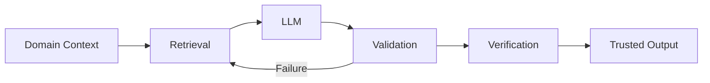

<div align="center">

# NAGADHAR SAI KANDERI

### Software Engineer · Backend · Cloud · Full Stack · AI


<br/>

<a href="https://github.com/nagadharsai">
  
</a>
<a href="https://www.linkedin.com/in/sai-kanderi-6588b72a0/">
  
</a>
<a href="https://x.com/nagadharsai">
  
</a>

<a href="https://www.reddit.com/user/NagadharSai/">
  
</a>
</div>

---

<!-- capability-library:start -->
## Browse my repositories

My account contains personal projects, learning work, and forks used as an AI engineering capability library. Reference forks retain upstream authorship; they are not presented as products I built.

**Personal project:** [Resume analysis API](https://github.com/nagadharsai/ai-resume-analyzer) — Java/Spring Boot rule-based prototype, with a frontend planned.

### Reusable capability groups

- [AI examples and learning](https://github.com/search?q=user%3Anagadharsai%20topic%3Agroup-ai-learning%20fork%3Atrue&type=repositories)
- [AI agents and developer tools](https://github.com/search?q=user%3Anagadharsai%20topic%3Agroup-ai-agents%20fork%3Atrue&type=repositories)
- [Agent skills and design guidance](https://github.com/search?q=user%3Anagadharsai%20topic%3Agroup-agent-skills%20fork%3Atrue&type=repositories)
- [UI components and styling](https://github.com/search?q=user%3Anagadharsai%20topic%3Agroup-ui-components%20fork%3Atrue&type=repositories)
- [Website builders and starters](https://github.com/search?q=user%3Anagadharsai%20topic%3Agroup-web-builders%20fork%3Atrue&type=repositories)
- [Dental applications and references](https://github.com/search?q=user%3Anagadharsai%20topic%3Agroup-dental-solutions%20fork%3Atrue&type=repositories)
- [Business platforms and infrastructure](https://github.com/search?q=user%3Anagadharsai%20topic%3Agroup-business-platforms%20fork%3Atrue&type=repositories)
- [Marketing and business development](https://github.com/search?q=user%3Anagadharsai%20topic%3Agroup-marketing-tools%20fork%3Atrue&type=repositories)
- [Automation and integrations](https://github.com/search?q=user%3Anagadharsai%20topic%3Agroup-automation%20fork%3Atrue&type=repositories)
- [Voice image and video](https://github.com/search?q=user%3Anagadharsai%20topic%3Agroup-voice-media%20fork%3Atrue&type=repositories)
- [Foundation model references](https://github.com/search?q=user%3Anagadharsai%20topic%3Agroup-foundation-models%20fork%3Atrue&type=repositories)
- [Career and software learning](https://github.com/search?q=user%3Anagadharsai%20topic%3Agroup-career-learning%20fork%3Atrue&type=repositories)
- [Testing and security utilities](https://github.com/search?q=user%3Anagadharsai%20topic%3Agroup-quality-security%20fork%3Atrue&type=repositories)
- [Personal and operating system utilities](https://github.com/search?q=user%3Anagadharsai%20topic%3Agroup-personal-utilities%20fork%3Atrue&type=repositories)
- [Personal portfolio and profile](https://github.com/search?q=user%3Anagadharsai%20topic%3Agroup-portfolio%20fork%3Atrue&type=repositories)
- [Personal application prototypes](https://github.com/search?q=user%3Anagadharsai%20topic%3Agroup-app-prototypes%20fork%3Atrue&type=repositories)
- [Learning archive and placeholders](https://github.com/search?q=user%3Anagadharsai%20topic%3Agroup-learning-archive%20fork%3Atrue&type=repositories)

Groups organize related capabilities; they do not certify production readiness. Component licenses, compatibility and tests are checked before reuse. Private company and client work stays separate.
<!-- capability-library:end -->

---

## `> whoami`

```text
Software Engineer with 8+ years of experience building
production systems across government, e-commerce,
automotive logistics, and enterprise environments.

Primary focus:
→ Backend Engineering
→ Distributed Systems
→ Cloud-Native Architecture
→ Full-Stack Development
→ AI-Integrated Software
```

I build software where **reliability, scalability, maintainability, and production behavior matter**.

My engineering background spans enterprise government systems, real-time eCommerce services, and automotive inventory & logistics platforms.

Today, I’m increasingly interested in the intersection of **traditional software engineering and reliable AI systems**.

---

## Engineering Experience

<table>
<tr>
<td width="25%" valign="top">

### 🏛️ New York State

**Office of the State Comptroller**

</td>
<td valign="top">

Worked on enterprise government applications with a focus on modernization, backend development, database-driven workflows, production reliability, maintainability, security, and compliance.

`Enterprise Systems` `Oracle` `PL/SQL` `PeopleSoft`

</td>
</tr>

<tr>
<td width="25%" valign="top">

### 📦 FedEx

**ShopRunner**

</td>
<td valign="top">

Backend engineering for **ShopRunner One Click Checkout**, supporting real-time eCommerce transactions through distributed services and APIs.

Worked with Java/Spring-based services, microservices, cloud infrastructure, databases, and production systems where performance and reliability were critical.

`Java` `Spring Boot` `Microservices` `AWS` `PostgreSQL`

</td>
</tr>

<tr>
<td width="25%" valign="top">

### 🚘 Mercedes-Benz

**Automotive Systems**

</td>
<td valign="top">

Worked on enterprise applications supporting **vehicle and automotive-parts inventory, logistics, and shipment tracking**.

The systems supported inventory visibility and movement of vehicles and parts between locations through logistics channels including **road, air, and sea transportation**.

`Java` `Spring Boot` `REST APIs` `SQL` `Enterprise Systems`

</td>
</tr>
</table>

---

## Technology Stack

### Languages

<div>

</div>

`SQL` · `PL/SQL`

### Backend & APIs

<div>

</div>

`Spring Boot` · `Spring` · `Hibernate` · `REST APIs` · `Microservices` · `GraphQL`

### Frontend

<div>

</div>

### Cloud & Infrastructure

<div>

</div>

`EC2` · `Lambda` · `ECS` · `S3` · `RDS` · `SQS` · `SNS`

### Data & Messaging

<div>

</div>

`Oracle` · `PostgreSQL` · `MongoDB` · `Redis` · `Kafka` · `Elasticsearch`

### Engineering Tooling

<div>

</div>

`CI/CD` · `GitHub Actions` · `Docker` · `Kubernetes`

---

## AI & Research Interests



I’m exploring ways to make AI systems **more dependable in real applications**, particularly around:

`Retrieval-Augmented Generation`

`LLM Reliability`

`Hallucination Reduction`

`Domain-Aware AI`

`SQL Generation`

`Expert-System Validation`

`Multi-Stage Verification`

`AI Agents`

The engineering problem that interests me most is not simply:

> **“Can an LLM generate an answer?”**

but:

> **“How do we know the answer is reliable enough for another system to trust?”**

---

## Featured Engineering Work

### 🤖 AI Resume Analyzer

**Rule-based resume analysis prototype**

Evaluates resumes, identifies skill gaps, and compares candidate profiles against job descriptions.

**Engineering focus**

`Java` · `Spring Boot` · `REST API` · `Rule-based matching`

The current implementation uses keyword checks. A frontend and model-based analysis are not implemented.

[**→ Explore Repository**](https://github.com/nagadharsai/ai-resume-analyzer)

---

### 🚧 More Production-Grade Projects Coming

I’m actively expanding this GitHub with projects focused on:

- distributed Java/Spring Boot systems
- event-driven microservices
- cloud-native architecture
- production observability
- AI + backend integration
- RAG and AI verification
- engineering automation
- real-world system design

The goal is **quality over repository count**.

---

## Currently Exploring

```text
01  Distributed backend architectures
02  Event-driven systems
03  Cloud-native Java applications
04  RAG + hallucination reduction
05  AI-assisted software engineering
06  AI agents and verification pipelines
07  Production observability & reliability
```

---

## Engineering Philosophy

```java
public final class Engineering {

    public static final String PRIORITY =
            "Reliability > Complexity";

    public static void build() {
        designForFailure();
        measureBeforeOptimizing();
        automateRepetition();
        writeMaintainableCode();
        validateAIOutputs();
        keepLearning();
    }
}
```

> Build systems that still make sense when the original developer is no longer in the room.

---

## Let's Connect

<div align="center">

### Interested in backend systems, cloud architecture, distributed software, or applied AI?

<a href="https://www.linkedin.com/in/sai-kanderi-6588b72a0/">
  
</a>

<a href="https://github.com/nagadharsai">
  
</a>

<br/><br/>

**Building software that scales. Exploring intelligence that can be trusted.**

</div>
